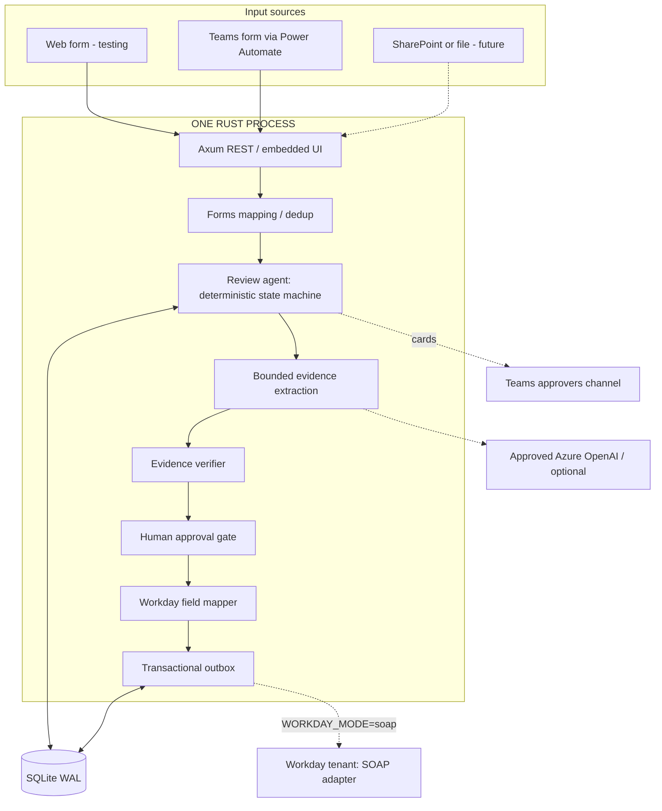
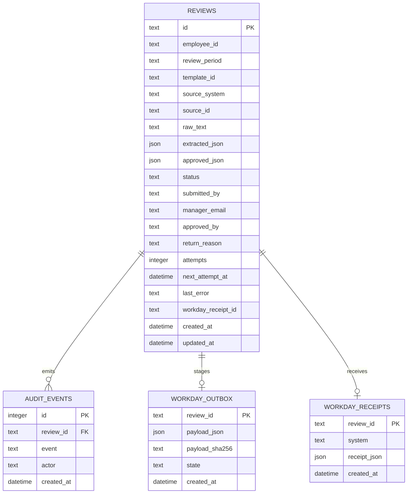
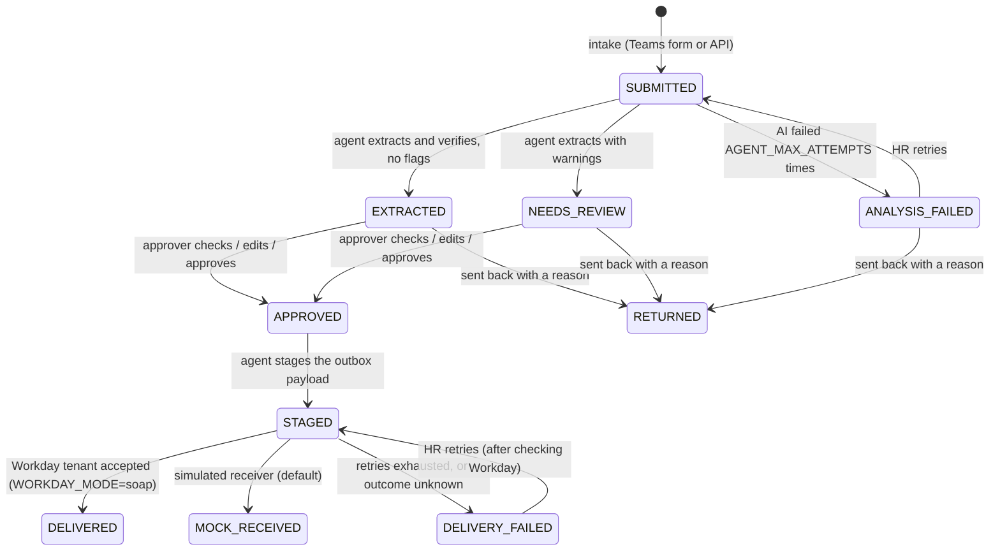
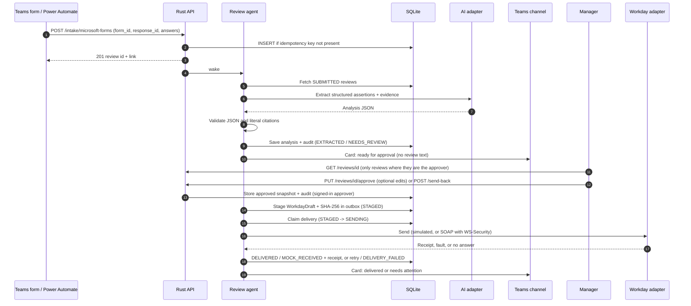
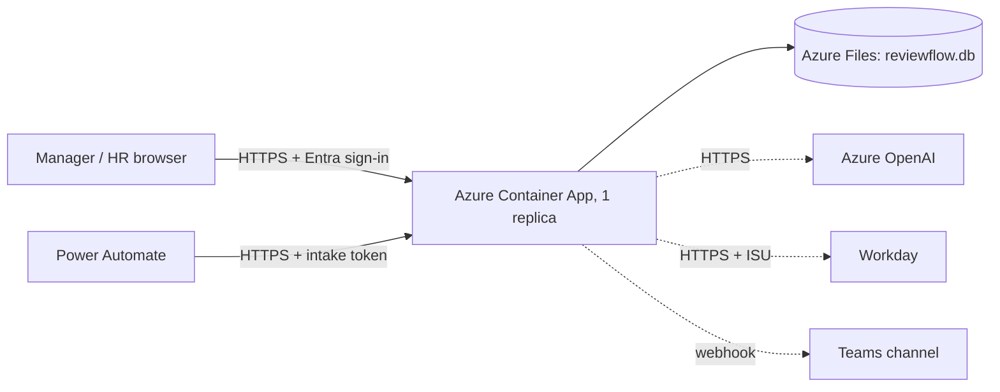

# How ReviewFlow is built

Last reviewed November 2026 (v0.4: Teams intake, review agent, Entra sign-in, Workday SOAP adapter).

In short: one Rust process, split into modules, with adapters at the edges, a transactional outbox, and a plain state machine. It handles confidential HR data, and a person approves anything the AI produces.

## 1. Problem and assumptions

Employees currently fill in self-reviews somewhere outside Workday. Their authored content must be normalized, optionally summarized, approved and mapped into the correct Workday review sections. We do **not** assume every review starts in a Teams chat: the source is a **Microsoft Forms self-review in Teams**, forwarded by a Power Automate flow (Microsoft Graph has no supported API for reading Forms responses). The embedded web form and REST endpoint remain for testing. Bulk scanning personal chats is not an intake mechanism for sensitive HR data.

The target Workday tenant is not yet specified. The product boundary is split into (A) source ingestion, (B) review workflow, (C) Workday connector. A and B are implemented. C has a simulated receiver (default) and a SOAP adapter driven by a tenant-supplied request template, which needs a sandbox test before live use.

### Business requirements

| ID | Requirement | POC | Product extension |
|---|---|---|---|
| R1 | Ingest authored review | Teams form via Power Automate; web form + REST for tests | SharePoint or other sources through the same intake |
| R2 | Normalize/AI-assist review | Review agent; rules, local Ollama or Azure OpenAI | Model governance, prompt/version registry |
| R3 | Ground insights in employee-authored evidence | Exact source quotes | Field-level policy engine and eval suite |
| R4 | Review, edit, approve | Web UI: edit, approve, send back; Entra sign-in with manager/HR roles | Multi-step approval chains, approval inside Teams |
| R5 | Map to correct Workday review | Stable WorkdayDraft schema | Tenant review template catalog, WSDL/XSD |
| R6 | Reliable delivery | Outbox, single-claim delivery, retries with backoff, simulated or SOAP adapter | Receipt reconciliation queries; EIB upload |
| R7 | Auditability and idempotency | SQLite events and dedup | Central immutable audit, retention policies |

### Non-goals

Automatic performance ratings, promotion recommendations, sentiment scoring, autonomously finalizing Workday business processes, scanning employee chats without approved purpose, exporting real HR data to personal spreadsheets.

## 2. High-level design (HLD)



**Deployment units:** **1 Rust process + 1 SQLite file**, on a laptop or one Azure Container App replica. Azure OpenAI is an optional external managed service, not a deployed internal component. The target Workday tenant already exists and is external.

## 3. Low-level design (LLD): modules

| Module | Responsibility | Contract | Failure behavior |
|---|---|---|---|
| `main.rs` | HTTP handlers, access checks, `--check-config` | `/api/v1/*` | 4xx/5xx, no raw HR content in errors |
| `auth.rs` | Shared tokens or Entra ID (Easy Auth) principal; manager/HR scoping | `Principal` | 401 not signed in, 403 no role, 404 for other teams' reviews |
| `intake.rs` | Microsoft Forms response to review | `FormsSubmission → NewReview` | 400 naming the missing answer |
| `agent.rs` | Background review agent | `Agent::tick` | Per-review failures recorded; never blocks other reviews |
| `domain.rs` | Canonical review, statuses, evidence JSON and validation | `Analysis`, `Review`, `NewReview` | Reject invalid input or uncited evidence |
| `ai.rs` | Rules, Ollama or Azure OpenAI adapter | `analyze(text) → Analysis` | 502 on provider/validation failure; no state change |
| `db.rs` | State transitions, IMMEDIATE transactions, dedup, audit, outbox, schema upgrades | `Store` methods | Atomic rollback; in-flight deliveries flagged on restart |
| `delivery.rs` | Claim, send, record one delivery | `deliver(...) → Outcome` | Unknown outcomes never resent automatically |
| `workday.rs` | Mapping, simulated + SOAP delivery, CSV staging | `WorkdayDraft`, `WorkdayClient` | Faults → rejected; timeouts → unknown; refused → unavailable |
| `teams.rs` | Workflows webhook cards | `Notifier::notify` | Best effort; failures only logged |
| `static/` | Simple embedded browser UI | calls REST API | no independent deployment |

### Core entities

**Review**: `id (UUID)`, `employee_id`, `review_period`, `template_id`, `source_system`, `source_id`, `raw_text`, `extracted`, `approved`, `status`, timestamps, plus `submitted_by`, `manager_email`, `approved_by`, `return_reason`, `workday_receipt_id` and retry bookkeeping (`attempts`, `next_attempt_at`, `last_error`). Unique constraint on `(source_system,source_id)` prevents duplicate ingestion. Columns added after v0.2 are created automatically on startup.

**EvidenceItem**: `text` plus `evidence`; `evidence` must be a literal contiguous substring of submitted review. This checks provenance of each extracted claim but **does not prove interpretation is correct**. Only the person approving can do that.

**AuditEvent**: review ID, event name, actor label, UTC timestamp. With `AUTH_MODE=entra` the actor is the signed-in account; in token mode it is a typed, unverified name.

**WorkdayOutbox**: review ID (unique), immutable staged JSON, SHA-256 digest, state (`STAGED`, `SENDING`, `UNKNOWN`, `DELIVERED`, `MOCK_RECEIVED`), timestamp. Staging and state transition commit in one SQLite transaction. A delivery first moves the row from `STAGED` to `SENDING`; only one caller can win that update.

**WorkdayReceipt**: review ID, system (`workday` or `simulated`), receipt JSON, timestamp.

### Logical database schema



### State machine



`MOCK_RECEIVED` is explicitly **not** a Workday receipt; only `DELIVERED` carries a Workday reference. A failed step is retried automatically with backoff (30s, 60s, ...), except a delivery whose outcome is unknown (timeout, connection dropped, server stopped mid-send), which goes straight to `DELIVERY_FAILED` so a person checks Workday before resending.

### Sequence design (SD)



## 4. Agents, kept small

| Logical agent | LLM? | Allowed tools/actions | Guardrail |
|---|---|---|---|
| **Intake agent** | No | Validate source identity, deduplicate, persist | Never accepts unauthorized message scraping |
| **Extraction agent** | Optional | Return strictly typed `Analysis` | Every assertion cites exact employee text |
| **Evidence validator** | No | JSON/schema/substring checks | Reject unsupported assertions |
| **Approval coordinator** | No | Offer record to assigned human approver | Cannot approve on its own |
| **Workday mapper** | No | Map approved contract to section IDs | Configuration and schema version pinned |
| **Delivery** | No | Stage, claim, send, record receipt | At most one sender per review; unknown outcomes need a person; no false success |

In code these are one review agent (`src/agent.rs`) calling ordinary functions, not six separate AI agents. That would add model cost, make tracing harder, and add more ways for things to fail, with nothing gained for the business. They're ordinary functions. Extraction is the only step where language understanding helps, and even that is optional.

### Agent prompt and validation principles

- LLM input is employee-authored **data**, never instructions.
- No rating, sentiment, protected-attribute inference or employment decision generation.
- Return a strict canonical JSON schema; fail closed if malformed.
- Require exact quote evidence for every extracted claim, even when summary is paraphrased.
- Every AI artifact carries `processor`, source review ID (via parent record), and an approval decision.
- Add prompt version, model version, calibration suite, structured output schema, and protected-attribute tests in production.

## 5. REST API contract

| Method | Endpoint | Access | Effect |
|---|---|---|---|
| GET | `/healthz` | Public | Health, AI/auth/Workday modes, agent and Teams settings |
| GET | `/api/v1/me` | Public | Who is signed in, their role, and the sign-in URL in Entra mode |
| POST | `/api/v1/intake/microsoft-forms` | Intake/employee token or reviewer | Teams (Microsoft Forms) response from Power Automate; idempotent on response ID |
| POST | `/api/v1/reviews` | Employee/intake token or reviewer | Idempotent create |
| GET | `/api/v1/reviews` | Reviewer | 100 most recent reviews the caller may see |
| GET | `/api/v1/reviews/{id}` | Reviewer | Original + extracted + approved |
| POST | `/api/v1/reviews/{id}/analyze` | Reviewer | Manual extract (the agent normally does this) |
| PUT | `/api/v1/reviews/{id}/approve` | Reviewer | Approve extraction or edited JSON; records the approver |
| POST | `/api/v1/reviews/{id}/send-back` | Reviewer | Return to employee with a reason (`RETURNED`) |
| POST | `/api/v1/reviews/{id}/retry` | Reviewer | Requeue `ANALYSIS_FAILED` or `DELIVERY_FAILED` |
| POST | `/api/v1/reviews/{id}/stage` | Reviewer | Manual stage, once (the agent normally does this) |
| GET | `/api/v1/reviews/{id}/audit` | Reviewer | Read event history |
| POST | `/api/v1/reviews/{id}/deliver` | Reviewer | Manual send through the configured adapter (`/mock-deliver` is an alias kept for old scripts) |
| GET | `/api/v1/workday/staging.csv` | HR | Download *generic* mapping CSV |

**Request examples:** `fixtures/sample-teams-form.json`, `fixtures/sample-review.json`. "Reviewer" means the reviewer token in `AUTH_MODE=token`, or an Entra user with the `ReviewFlow.Reviewer` (own team only) or `ReviewFlow.HR` (everything) role in `AUTH_MODE=entra`. Managers get 404 for other teams' reviews.

## 6. Workday integration design

Workday performance-review interfaces include **Import Employee Reviews**, **Put Employee Reviews**, **Start Performance Review** and others. **Do not hard-code an API name and assume it supports all tenant-defined self-evaluation stages**. Validate in the Workday SOAP API Explorer and actual sandbox business process.

**Recommended adapter boundary:**

```text
ApprovedReview
  └── WorkdayDraft (vendor-neutral, versioned canonical schema)
        ├── SimulatedWorkday                      [implemented, default]
        ├── SOAP adapter (WORKDAY_MODE=soap)      [implemented]
        │     envelope + WS-Security UsernameToken, tenant request template,
        │     fault / timeout / refused classification, receipt element
        ├── staging_csv                           [implemented, generic CSV]
        └── EIB template adapter                  [not built; adapt staging_csv]
```

The production Workday connector must configure:

1. Tenant and endpoint, WWS API version, integration-system user and minimal integration security domains.
2. Actual Workday employee/worker reference mapping. Do not assume `EMP-001` is a Workday WID.
3. Review category/type/template ID and the **correct review business-process stage** (self-evaluation vs manager evaluation).
4. Section IDs, competency/goal references, allowed comments/ratings, formatting and field lengths.
5. Create vs update semantics and read-after-write / integration event status to confirm completion.
6. Custom EIB XML/CSV schema or SOAP payload from tenant metadata, not guessed from this POC.
7. Error cases: missing worker, stale review, duplicate period, closed event, validation rejects, partial bulk import.

### Workday integration design tradeoff

**EIB**: less code and tenant-friendly bulk loading, but batch oriented and template-specific; partial failures need reconciliation. **SOAP**: more programmatic and lower-latency, but XML/WS-Security/operation/business-process complexity. Start with a tenant-approved EIB if available for the exact workflow; switch to SOAP only when response-time or per-review workflow control requires it.

## 7. Throughput, latency and capacity design

No measured traffic profile was provided. Do not commit to invented capacity numbers. For planning, capture:

- Monthly review population, seasonal peak, text size, employee vs manager-review mix.
- Target submission response and time-to-Workday confirmation SLOs.
- Permitted Azure OpenAI token budgets and Workday concurrency limits.
- Workday maintenance windows and integration throttling.

**Optimization choices:** short immutable review snapshots; one review per model call; constrained output; cache only reference template metadata, never employee review text; SQLite WAL; one shared HTTP client for AI; bounded request size; deterministic validation; no vector embeddings, no Kafka, no Redis.

**Scale-up path:** change `Store` from SQLite to PostgreSQL, run a worker loop against outbox with leased jobs, and run multiple Rust stateless API replicas behind a load balancer. The REST contracts and WorkdayDraft contract stay stable.

## 8. Failure and idempotency model

- **Duplicate submission**: `(source_system, source_id)` unique; changed payload with reused key gives HTTP 409.
- **AI outage**: no partial JSON persisted; request fails with 502; retry the `SUBMITTED` review.
- **AI hallucination**: unsupported exact quote rejected; human still checks semantic correctness.
- **Approve before analysis**: HTTP 409.
- **Stage before approval**: HTTP 409.
- **Double stage**: same persisted `STAGED` review, not another outbox entry.
- **DB failure**: transaction rollback; no claim of successful staging.
- **Workday outage** (connection refused, 429/502/503): retried with backoff, then `DELIVERY_FAILED`.
- **Workday rejection** (SOAP fault, 4xx): retried with backoff (some faults are transient), then `DELIVERY_FAILED` with the fault text.
- **Ambiguous Workday outcome** (timeout, dropped connection, 504, server stopped mid-send): straight to `DELIVERY_FAILED`, never resent automatically. A person checks Workday, then retries.
- **Concurrent delivery** (agent and a manual click): only one caller can claim the outbox row.

## 9. Deployment topology



**Local demo:** `cargo run` or the launcher, a writable local directory, shared tokens.
**Live (v1):** one Azure Container App replica with built-in authentication, Azure Files for the database (`SQLITE_JOURNAL_MODE=DELETE`), Key Vault for secrets. See [GO-LIVE.md](GO-LIVE.md).  
**Higher scale:** separate *process roles* (API and worker) from the same codebase when warranted; separate deployments only as reliability warrants.

## 10. Detailed production milestones

Done in v0.3–v0.4: Teams intake, review agent with retries, edit / send-back UI, Entra sign-in with manager/HR scoping, Workday SOAP adapter. Remaining:

1. Get the tenant request template and integration user; test against the Workday sandbox ([GO-LIVE.md](GO-LIVE.md)).
2. Derive the employee and manager from Entra/Workday instead of form answers.
3. Receipt reconciliation (query Workday before a manual retry of an unknown outcome).
4. PostgreSQL and a separate worker role if more than one replica is needed.
5. OpenTelemetry and privacy-preserving monitoring.
6. Model evaluations, HR/DPO security sign-off, accessibility, DLP, backups and disaster recovery.

## 11. References

- [Workday performance review setup and web service operations](https://doc.workday.com/admin-guide/en-us/human-capital-management/talent/employee-reviews/performance-reviews/ham1552329509919.html)
- [Workday review templates and EIB](https://doc.workday.com/workday-education/en-us/course-manuals/talent-for-administrators/employee-review-template.html)
- [Workday SOAP API reference](https://community-content.workday.com/en-us/public/products/platform-and-product-extensions/soap-api-reference.html)
- [Workday integration tools](https://doc.workday.com/workday-education/en-us/course-manuals/creating-and-securing-integrations/workday-integrations-overview.html)
- [Teams Graph API message access](https://learn.microsoft.com/en-us/graph/api/chat-list-messages)
- [Teams change notifications](https://learn.microsoft.com/en-us/graph/teams-changenotifications-chatmessage)


## Teams intake and the review agent (added in v0.3)

`Teams form -> Power Automate -> /intake/microsoft-forms -> SUBMITTED -> agent -> EXTRACTED|NEEDS_REVIEW -> Teams card -> human approve | send back -> agent stages -> agent delivers (simulated or SOAP)`

- **Intake** (`src/intake.rs`): maps a Forms response to a review by question-title keywords. Answers are stored verbatim under section headings so evidence checks still work. The idempotency key is `microsoft-forms:<form_id>` plus the response ID.
- **Agent** (`src/agent.rs`): a background task in the same process. It polls every `AGENT_POLL_SECONDS`, and API calls wake it immediately. It summarizes `SUBMITTED`, stages `APPROVED` and delivers `STAGED` reviews. A failed step is retried with exponential backoff (30s, 60s, ...) and moves to `ANALYSIS_FAILED` / `DELIVERY_FAILED` after `AGENT_MAX_ATTEMPTS`, where HR can retry it. It is a fixed state machine, not an LLM planner, and it has no approve capability.
- **Notifications** (`src/teams.rs`): best-effort cards to a Teams Workflows webhook. They carry only IDs and status, never review content.
- **States added:** `RETURNED`, `ANALYSIS_FAILED`, `DELIVERY_FAILED` (v0.3), `DELIVERED` (v0.4). Retry bookkeeping (`attempts`, `next_attempt_at`, `last_error`) lives on the review row. `last_error` holds only content-free error messages.

## Entra sign-in and Workday SOAP (added in v0.4)

- **Sign-in** (`src/auth.rs`): `AUTH_MODE=entra` trusts the `X-MS-CLIENT-PRINCIPAL` header set by Azure built-in authentication and maps Entra app roles to manager (`ENTRA_REVIEWER_ROLE`) and HR (`ENTRA_HR_ROLE`). Managers see only reviews whose `manager_email` matches their sign-in.
- **Workday** (`src/workday.rs`, `src/delivery.rs`): `WORKDAY_MODE=soap` posts a SOAP envelope with a WS-Security UsernameToken. The body comes from `workday/request-template.xml` with XML-escaped placeholders. The server refuses to start while the example marker is still in the template.
- **Readiness**: `reviewflow --check-config` validates settings and lists components still in demo mode.

## Local AI with Ollama (added in v0.2)

`UI/API -> Rust validation -> Processor::Ollama -> local Ollama /api/chat -> typed JSON -> verbatim evidence validation -> human approval -> mock Workday staging`

The Ollama adapter is in `src/ai.rs` alongside the existing offline rules and Azure adapters. `AI_MODE=rules|ollama|azure` chooses the implementation at server startup. The Ollama mode requires Ollama as a separate local process but no additional Rust service, queue, or agent deployment. Its model is configurable via `OLLAMA_MODEL`, default `qwen3:4b-instruct`; `OLLAMA_BASE_URL` is deliberately limited to local loopback or Docker Desktop's `host.docker.internal`. Avoid real HR content until the POC's authentication and disk security are production hardened.
