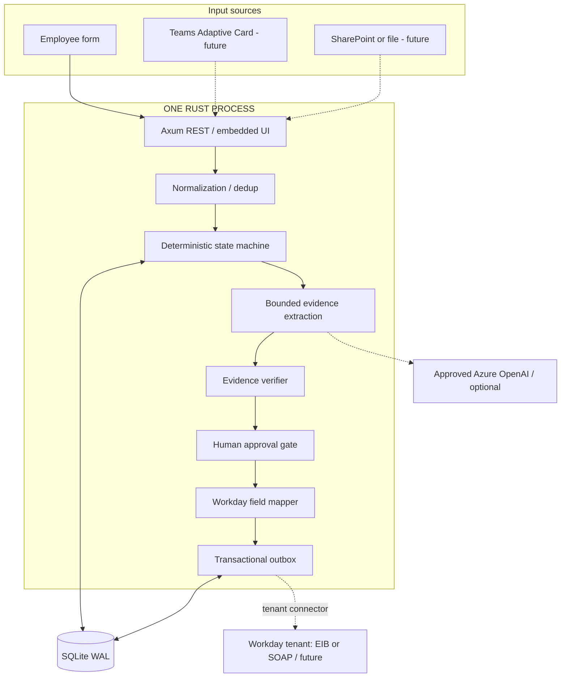
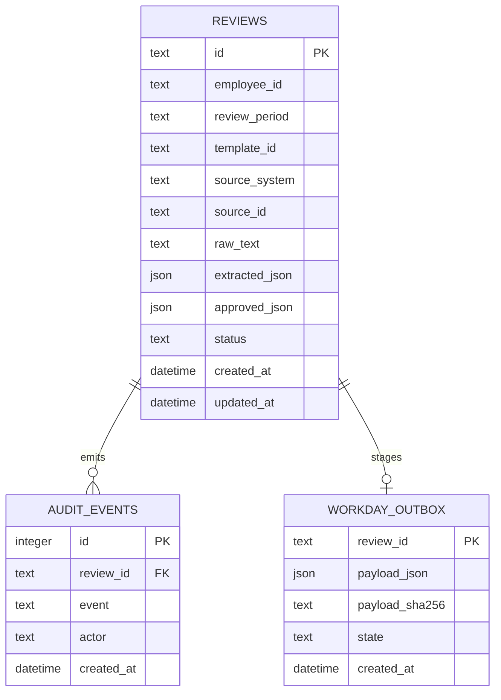
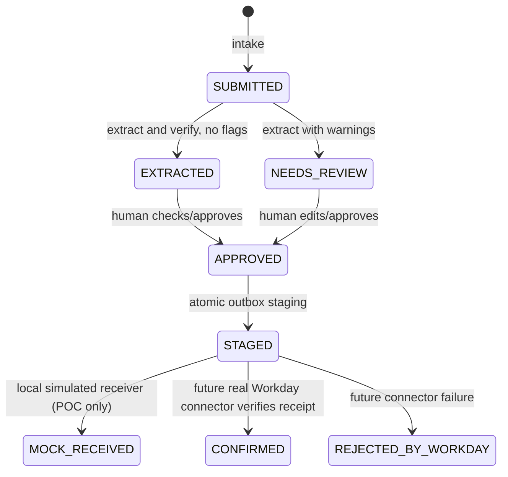
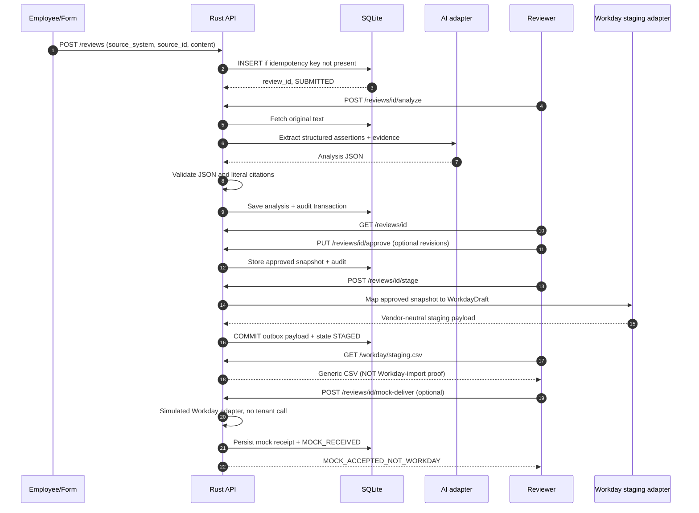
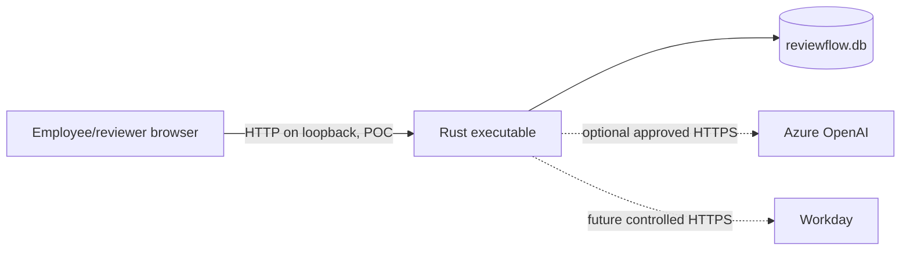

# How ReviewFlow is built

Last reviewed November 2026.

In short: one Rust process, split into modules, with adapters at the edges, a transactional outbox, and a plain state machine. It handles confidential HR data, and a person approves anything the AI produces.

## 1. Problem and assumptions

Employees currently fill in self-reviews somewhere outside Workday. Their authored content must be normalized, optionally summarized, approved and mapped into the correct Workday review sections. We do **not** assume every review starts in a Teams chat: for the POC the source is a structured UI / REST endpoint. In production, Teams should present a **purpose-built form or Adaptive Card** with user consent; bulk scanning personal chats is not the recommended intake mechanism for sensitive HR data.

Inputs and target Workday tenant are not yet specified. Therefore the product boundary is split into (A) source ingestion, (B) review workflow, (C) Workday connector. Only B plus a local A and a staging/**simulated** implementation of C are delivered.

### Business requirements

| ID | Requirement | POC | Product extension |
|---|---|---|---|
| R1 | Ingest authored review | Web form + REST | Graph/Teams Forms/SharePoint/etc. |
| R2 | Normalize/AI-assist review | Rules or Azure OpenAI | Model governance, prompt/version registry |
| R3 | Ground insights in employee-authored evidence | Exact source quotes | Field-level policy engine and eval suite |
| R4 | Review, edit, approve | Reviewer API + simplified UI | SSO, manager/HR multi-step approval |
| R5 | Map to correct Workday review | Stable WorkdayDraft schema | Tenant review template catalog, WSDL/XSD |
| R6 | Reliable delivery | Local durable outbox + CSV + in-process mock receipt | EIB upload or SOAP with authoritative receipt reconciliation |
| R7 | Auditability and idempotency | SQLite events and dedup | Central immutable audit, retention policies |

### Non-goals

Automatic performance ratings, promotion recommendations, sentiment scoring, autonomously finalizing Workday business processes, scanning employee chats without approved purpose, exporting real HR data to personal spreadsheets.

## 2. High-level design (HLD)



**Deployment units:** POC runs as **1 Rust process + 1 local SQLite file**. Azure OpenAI is an optional external managed service, not a deployed internal component. The target Workday tenant already exists and is external.

## 3. Low-level design (LLD): modules

| Module | Responsibility | Contract | Failure behavior |
|---|---|---|---|
| `main.rs` | HTTP handlers and token-based POC auth | `/api/v1/*` | 4xx/5xx, no raw HR content in errors |
| `domain.rs` | Canonical review, evidence JSON and validation | `Analysis`, `Review`, `NewReview` | Reject invalid input or uncited evidence |
| `ai.rs` | Offline parser or Azure LLM adapter | `analyze(text) → Analysis` | 502 on provider/validation failure; no state change |
| `db.rs` | State transitions, transactions, dedup, audit, outbox | `Store` methods | Atomic transaction rollback |
| `workday.rs` | Vendor-neutral mapping and CSV staging | `WorkdayDraft` | No implied Workday receipt |
| `static/` | Simple embedded browser UI | calls REST API | no independent deployment |

### Core entities

**Review**: `id (UUID)`, `employee_id`, `review_period`, `template_id`, `source_system`, `source_id`, `raw_text`, `extracted`, `approved`, `status`, timestamps. Unique constraint on `(source_system,source_id)` prevents duplicate ingestion.

**EvidenceItem**: `text` plus `evidence`; `evidence` must be a literal contiguous substring of submitted review. This checks provenance of each extracted claim but **does not prove interpretation is correct**. Only the person approving can do that.

**AuditEvent**: review ID, event name, actor label, UTC timestamp. POC actor is a token role, not a verified human identity.

**WorkdayOutbox**: review ID (unique), immutable staged JSON, SHA-256 digest, state, timestamp. Staging and state transition commit in one SQLite transaction.

### Logical database schema



### State machine



POC states extend to `MOCK_RECEIVED` (explicitly **not** a Workday receipt). `CONFIRMED` and `REJECTED_BY_WORKDAY` are future production states. No retry from `STAGED` until the Workday connector and reconciliation policies are configured.

### Sequence design (SD)



## 4. Agents, kept small

| Logical agent | LLM? | Allowed tools/actions | Guardrail |
|---|---|---|---|
| **Intake agent** | No | Validate source identity, deduplicate, persist | Never accepts unauthorized message scraping |
| **Extraction agent** | Optional | Return strictly typed `Analysis` | Every assertion cites exact employee text |
| **Evidence validator** | No | JSON/schema/substring checks | Reject unsupported assertions |
| **Approval coordinator** | No | Offer record to assigned human approver | Cannot approve on its own |
| **Workday mapper** | No | Map approved contract to section IDs | Configuration and schema version pinned |
| **Delivery/reconciliation** | No | Stage, send (future), verify receipt | At-least-once + idempotency, no false success |

I didn't make these six separate AI agents. That would add model cost, make tracing harder, and add more ways for things to fail, with nothing gained for the business. They're ordinary functions. Extraction is the only step where language understanding helps, and even that is optional.

### Agent prompt and validation principles

- LLM input is employee-authored **data**, never instructions.
- No rating, sentiment, protected-attribute inference or employment decision generation.
- Return a strict canonical JSON schema; fail closed if malformed.
- Require exact quote evidence for every extracted claim, even when summary is paraphrased.
- Every AI artifact carries `processor`, source review ID (via parent record), and an approval decision.
- Add prompt version, model version, calibration suite, structured output schema, and protected-attribute tests in production.

## 5. REST API contract (POC)

| Method | Endpoint | Access | Effect |
|---|---|---|---|
| GET | `/healthz` | Public | Health and explicit staging-only state |
| POST | `/api/v1/reviews` | Employee/reviewer token | Idempotent create |
| GET | `/api/v1/reviews` | Reviewer token | 100 most recent reviews (POC) |
| GET | `/api/v1/reviews/{id}` | Reviewer token | Original + extracted + approved |
| POST | `/api/v1/reviews/{id}/analyze` | Reviewer token | Extract and validate evidence |
| PUT | `/api/v1/reviews/{id}/approve` | Reviewer token | Approve extraction or edited JSON |
| POST | `/api/v1/reviews/{id}/stage` | Reviewer token | Transactionally stage once |
| GET | `/api/v1/reviews/{id}/audit` | Reviewer token | Read event history |
| POST | `/api/v1/reviews/{id}/mock-deliver` | Reviewer token | In-process fake receipt, NOT Workday |
| GET | `/api/v1/workday/staging.csv` | Reviewer token | Download *generic* mapping CSV |

**Request example:** `fixtures/sample-review.json`. All endpoints except health/UI require `Authorization: Bearer <token>`. This auth is developer-only and must not be shipped for HR production.

## 6. Workday integration design

Workday performance-review interfaces include **Import Employee Reviews**, **Put Employee Reviews**, **Start Performance Review** and others. **Do not hard-code an API name and assume it supports all tenant-defined self-evaluation stages**. Validate in the Workday SOAP API Explorer and actual sandbox business process.

**Recommended adapter boundary:**

```text
ApprovedReview
  └── WorkdayDraft (vendor-neutral, versioned canonical schema)
        ├── POC: StagingCsvAdapter + SimulatedWorkday [implemented]
        ├── Product A: TenantEibAdapter -> exact inbound EIB template
        └── Product B: TenantSoapAdapter -> versioned WSDL + WS-Security
                                     -> parse response and verify transaction
```

The production Workday connector must configure:

1. Tenant and endpoint, WWS API version, integration-system user and minimal integration security domains.
2. Actual Workday employee/worker reference mapping. Do not assume `EMP-001` is a Workday WID.
3. Review category/type/template ID and the **correct review business-process stage** (self-evaluation vs manager evaluation).
4. Section IDs, competency/goal references, allowed comments/ratings, formatting and field lengths.
5. Create vs update semantics and read-after-write / integration event status to confirm completion.
6. Custom EIB XML/CSV schema or SOAP payload from tenant metadata, not guessed from this POC.
7. Error cases: missing worker, stale review, duplicate period, closed event, validation rejects, partial bulk import.

### Workday integration design tradeoff

**EIB**: less code and tenant-friendly bulk loading, but batch oriented and template-specific; partial failures need reconciliation. **SOAP**: more programmatic and lower-latency, but XML/WS-Security/operation/business-process complexity. Start with a tenant-approved EIB if available for the exact workflow; switch to SOAP only when response-time or per-review workflow control requires it.

## 7. Throughput, latency and capacity design

No measured traffic profile was provided. Do not commit to invented capacity numbers. For planning, capture:

- Monthly review population, seasonal peak, text size, employee vs manager-review mix.
- Target submission response and time-to-Workday confirmation SLOs.
- Permitted Azure OpenAI token budgets and Workday concurrency limits.
- Workday maintenance windows and integration throttling.

**Optimization choices:** short immutable review snapshots; one review per model call; constrained output; cache only reference template metadata, never employee review text; SQLite WAL; one shared HTTP client for AI; bounded request size; deterministic validation; no vector embeddings, no Kafka, no Redis.

**Scale-up path:** change `Store` from SQLite to PostgreSQL, run a worker loop against outbox with leased jobs, and run multiple Rust stateless API replicas behind a load balancer. The REST contracts and WorkdayDraft contract stay stable.

## 8. Failure and idempotency model

- **Duplicate submission**: `(source_system, source_id)` unique; changed payload with reused key gives HTTP 409.
- **AI outage**: no partial JSON persisted; request fails with 502; retry the `SUBMITTED` review.
- **AI hallucination**: unsupported exact quote rejected; human still checks semantic correctness.
- **Approve before analysis**: HTTP 409.
- **Stage before approval**: HTTP 409.
- **Double stage**: same persisted `STAGED` review, not another outbox entry.
- **DB failure**: transaction rollback; no claim of successful staging.
- **Workday outage**: POC unaffected because its mock does not call Workday; production worker retries with jitter and deduplicated reference IDs.
- **Ambiguous Workday outcome**: production implementation must query integration status before replay to prevent duplicate review events.

## 9. Deployment topology



**POC:** no Docker required; `cargo run` and a writable local directory.  
**Product v1:** one Azure Container App (or VM) plus a managed PostgreSQL instance only if HA is required; use Entra ID and an approved secret manager.  
**Higher scale:** separate *process roles* (API and worker) from the same codebase when warranted; separate deployments only as reliability warrants.

## 10. Detailed production milestones

1. Confirm review source and real Workday sandbox EIB/SOAP schema; obtain tenant template and integration-system permissions.
2. Replace shared tokens with OIDC + employee ID from identity provider + per-review RBAC.
3. Build source connector (prefer structured Teams/Forms submission) with source revisions and retention controls.
4. Build tenant-specific Workday mapper and integration; verify receipt and reconciliation across business-process stages.
5. Implement reviewer diff/edit UI, separation of duties and explicit human sign-off.
6. Add retries, leases, dead-letter tracking, OpenTelemetry and privacy-preserving monitoring.
7. Complete model evaluations, HR/DPO security signoff, accessibility, DLP, backups and disaster recovery.

## 11. References

- [Workday performance review setup and web service operations](https://doc.workday.com/admin-guide/en-us/human-capital-management/talent/employee-reviews/performance-reviews/ham1552329509919.html)
- [Workday review templates and EIB](https://doc.workday.com/workday-education/en-us/course-manuals/talent-for-administrators/employee-review-template.html)
- [Workday SOAP API reference](https://community-content.workday.com/en-us/public/products/platform-and-product-extensions/soap-api-reference.html)
- [Workday integration tools](https://doc.workday.com/workday-education/en-us/course-manuals/creating-and-securing-integrations/workday-integrations-overview.html)
- [Teams Graph API message access](https://learn.microsoft.com/en-us/graph/api/chat-list-messages)
- [Teams change notifications](https://learn.microsoft.com/en-us/graph/teams-changenotifications-chatmessage)


## Local AI with Ollama (added in v0.2)

`UI/API -> Rust validation -> Processor::Ollama -> local Ollama /api/chat -> typed JSON -> verbatim evidence validation -> human approval -> mock Workday staging`

The Ollama adapter is in `src/ai.rs` alongside the existing offline rules and Azure adapters. `AI_MODE=rules|ollama|azure` chooses the implementation at server startup. The Ollama mode requires Ollama as a separate local process but no additional Rust service, queue, or agent deployment. Its model is configurable via `OLLAMA_MODEL`, default `qwen3:4b-instruct`; `OLLAMA_BASE_URL` is deliberately limited to local loopback or Docker Desktop's `host.docker.internal`. Avoid real HR content until the POC's authentication and disk security are production hardened.
